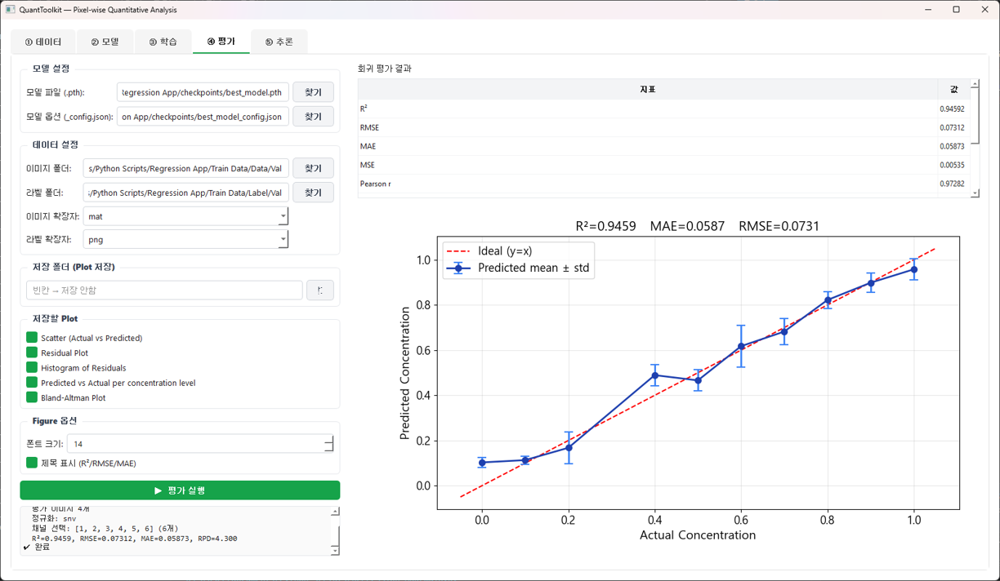

# QuantToolkit

**Pixel-wise quantitative analysis for multispectral imaging**

Deep learning toolkit for predicting continuous values (e.g., concentration) at the pixel level from multispectral/hyperspectral images.

## Features

- **Two operation modes**
  - **Patch-based CNN** — predict concentration per pixel from local patches (8 models)
  - **Dense U-Net regression** — predict full concentration map at once (7 SMP encoders)

- **Supported models**

  Patch mode (8):
  - CNN-2D-Simple (3-layer baseline)
  - CNN-2D-ResNet18/34/50
  - CNN-2D-EfficientNet-B0/B2
  - CNN-1D-Spectral (spectrum-only)
  - MLP-Spectral

  Dense mode (7):
  - UNet, UNet++, MAnet, FPN, Linknet, PAN, DeepLabV3+

- **Regression-specific features**
  - Background masking (label==bg_value excluded from loss)
  - Multiple loss functions (MSE / L1 / Huber)
  - Auto label-to-concentration conversion: `(label + offset) / divisor`
  - K-Fold CV with R² mean ± std summary
  - Auto-padding for SMP CNN models (input size auto-aligned to 32x)

- **Evaluation**
  - Metrics: R², RMSE, MAE, Pearson r, Bias
  - Plots: Scatter, Residual, Histogram, Per-level mean±std, Bland-Altman
  - All saved as PNG to user-specified folder

- **Inference**
  - Three ROI masking modes: None / GT-based / Threshold-based
  - Saves concentration map as `.npy` and colored `.png`
  - Pixel-level statistics: mean, std, min, max, median
  - Real-time visualization with selectable colormaps

## Workflow

```
① Data tab
   ├─ Set image / concentration label folders
   ├─ Define label → concentration formula
   └─ Choose split mode (manual / hold-out / K-Fold)

② Model tab
   ├─ Select mode: Patch or Dense
   ├─ Choose architecture
   ├─ Auto-detect channels / size from data
   └─ Set output activation (linear recommended)

③ Train tab
   ├─ Set hyperparameters
   ├─ Choose loss (MSE / L1 / Huber)
   └─ Monitor Loss + R² curves real-time

④ Evaluate tab
   ├─ Load .pth + auto-detect _config.json
   ├─ Compute R², RMSE, MAE etc.
   └─ Save scatter / residual / Bland-Altman plots

⑤ Infer tab
   ├─ Auto-synced from eval tab
   ├─ Choose ROI mask mode
   └─ Output concentration map + statistics
```

## Installation

```bash
pip install -r requirements.txt
```

## Run

```bash
python main.py
```
