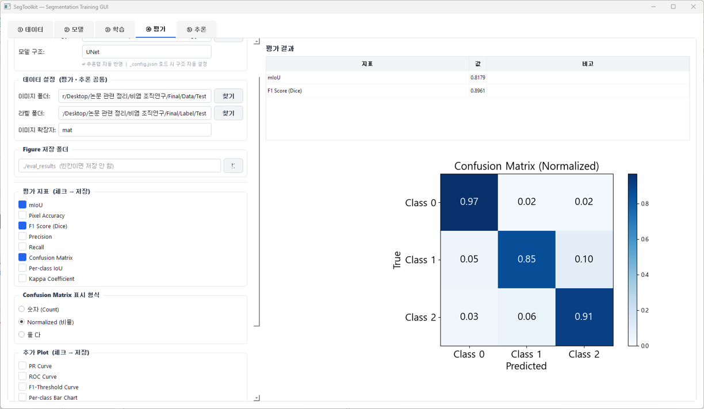

# SegToolkit

A PyQt5-based GUI application for semantic segmentation model training, evaluation, and inference.  
Supports hyperspectral (multi-channel), grayscale, and RGB images.

---

## Features

- **Multi-format support**: PNG, JPG, TIFF, MAT, NPY, HDR
- **Model selection**: UNet, UNet++, SegFormer-B0/B2/B4, DeepLabV3+, Mask2Former + external model loading
- **Pretrained weights**: ImageNet / ImageNet-22K via HuggingFace
- **Split strategies**: Manual Train/Val split · Hold-out · Stratified K-Fold
- **Class weights**: Per-class loss weighting for imbalanced datasets
- **Real-time training plot**: Loss & mIoU curves
- **Independent evaluation**: Load any `.pth` without re-training
- **Batch inference**: Free folder selection (train / val / test)
- **Overlay export**: Predicted mask overlaid on original image, per-class color customizable
- **Extensible model registry**: Add a new `.py` file to `models/` — auto-detected on startup

---

## Installation

```bash
git clone https://github.com/yourname/SegToolkit.git
cd SegToolkit
pip install -r requirements.txt
python main.py
```

---

## Workflow

```
① Data   →  ② Model   →  ③ Train   →  ④ Eval   →  ⑤ Infer
(path/split)  (arch/weight) (hyperparam)  (metrics)  (overlay save)
```

Evaluation and Inference tabs work independently — load any saved `.pth` directly.

---

## Adding a New Model

1. Create `models/my_model.py` with a class that inherits `nn.Module`
2. Restart the app — the model appears in the dropdown automatically

---

## License

MIT
