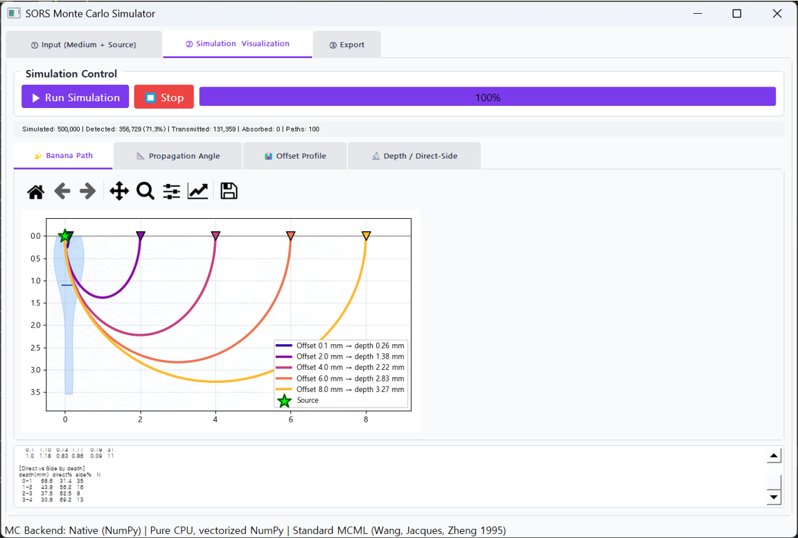

# SORS Monte Carlo Simulator

Simulates photon transport in multi-layered turbid media to predict the optical behavior of
**SORS (Spatially Offset Raman Spectroscopy)** measurements.



---

## Backends

The app automatically selects one of two Monte Carlo backends at runtime:

| Backend | Speed (1M photons) | Requires | Notes |
|---------|--------------------|----------|-------|
| **PMCX (MCX)** ⭐ | < 1 s | NVIDIA GPU + CUDA | GPU-accelerated, standard tool in biomedical optics |
| **Native (NumPy)** | ~38 s | — | Pure Python fallback, runs without a GPU |

On startup the app checks whether PMCX is available and uses it if possible, otherwise it falls
back to the native backend automatically. The active backend is shown in the status bar.

References: Fang & Boas, *Opt. Express* 17(22):20178-90 (2009) for MCX;
Wang, Jacques & Zheng, *Comput. Methods Programs Biomed.* 47(2):131-46 (1995) for the MCML algorithm.

---

## Installation

```bash
pip install -r requirements.txt
```

Optional GPU acceleration (NVIDIA GPU with CUDA toolkit installed):

```bash
pip install pmcx
```

Verify the GPU is visible with `nvidia-smi`.

---

## Run

```bash
python main.py
```

Force a specific backend via environment variable if needed:

```bash
MC_BACKEND=pmcx   python main.py   # force GPU
MC_BACKEND=native python main.py   # force CPU
MC_BACKEND=auto   python main.py   # default
```

---

## Usage

**Input tab** — choose a preset (e.g. pork muscle @ 830 nm) or build a custom multi-layer
medium (`+ Add Layer`), set photon count (10k for testing, up to 1M for accuracy), and the
maximum detection offset.

**Simulation tab** — run the simulation and view three visualizations:
- **Banana Path** — representative photon path curves
- **Propagation Angle** — radial distribution with mean angle
- **Offset Profile** — distribution of where photons return to the surface

**Export tab** — save results as `.npz` (Python), `.csv` (Excel/MATLAB), or per-photon detection data.

---

## Optical property units

| Parameter | Unit | Meaning |
|-----------|------|---------|
| μa | mm⁻¹ | absorption coefficient |
| μs | mm⁻¹ | scattering coefficient |
| g | – | anisotropy (Henyey-Greenstein) |
| n | – | refractive index |
| μs′ | cm⁻¹ | reduced scattering (derived) |