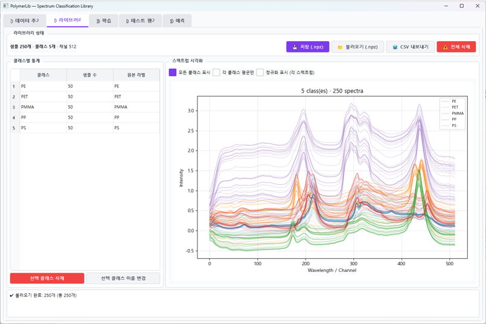

# PolymerLib — Polymer Spectrum Classification

A PyQt5 application to train polymer classification models from labeled spectra and manage a
growing spectral database.



---

## Features

**Data** — load spectra (`.txt`, `.csv`, `.dat`, `.asc`) in various layouts (single-column,
wavelength+intensity, multi-column) with auto/manual delimiter detection. Labels can be extracted
from filenames, and fine-grained labels mapped to broader classes (e.g. sub-types → `PET`).

**Library** — per-class statistics, spectrum visualization (color by label, optional mean ± std),
save/load as `.npz`, CSV export, and class rename/delete.

**Train** — SVM, KNN, Random Forest, or MLP classifiers, with selectable normalization
(StandardScaler, MinMaxScaler, SNV, none), stratified K-Fold cross-validation, confusion matrix,
and classification report (precision / recall / F1). Models saved as `.joblib`.

**Predict** — batch prediction on new spectra with class probabilities, top-2 results,
visualization, and CSV export.

---

## Installation & Run

```bash
pip install -r requirements.txt
python main.py
```

---

## Workflow

```
Spectrum files
   ↓  (extract label from filename)
Raw labels
   ↓  (apply mapping rules → broad class)
Library (database)
   ↓  (stratified K-Fold CV)
Train model
   ↓
Predict on new spectra
```

---

## Input format

No data is included in this repository. Spectra are plain text/CSV with an intensity column
(optionally a wavelength column). Preprocessing beyond the built-in normalization options is left
to the user.