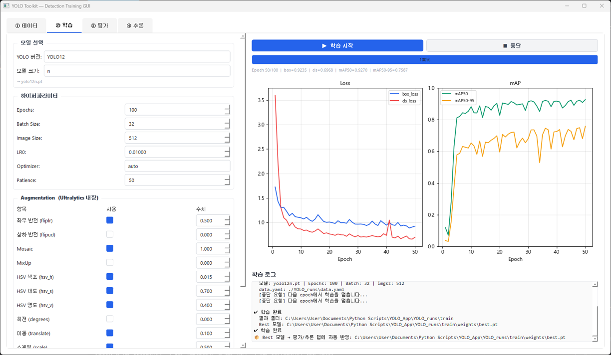

# YOLO Toolkit

A PyQt5 GUI for the full YOLO object-detection workflow — dataset setup, training, evaluation,
and batch inference — built on **Ultralytics YOLO**.



---

## Features

**Data** — set train / val image and label (`.txt`) folders, choose a split strategy
(manual train/val · hold-out · K-Fold), define class names, and scan / verify the dataset
(auto-suggests class count from label files). Generates the `data.yaml` used for training.

**Train** — configure and launch training; runs on GPU when available, CPU otherwise.

**Eval** — run `YOLO.val()` on any `.pt` model + `data.yaml`, reporting mAP50, mAP50-95,
precision, recall, and per-class AP50. Ultralytics result plots (confusion matrix, PR curve, etc.)
are shown in-app.

**Infer** — batch prediction on an image folder with adjustable confidence / IoU / image size,
live preview of boxed results, and saved `_pred.png` outputs.

Tabs are connected: the trained model and `data.yaml` flow automatically into Eval and Infer.

---

## Installation

```bash
pip install -r requirements.txt
```

Requires `ultralytics` and `torch` (GPU build recommended for training).

---

## Run

```bash
python yolo_main.py
```

---

## Workflow

```
① Data   →  ② Train   →  ③ Eval   →  ④ Infer
(paths / split /   (train model)  (mAP, curves)  (batch predict,
 classes → yaml)                                  boxed previews)
```

---

## Input format

No data is included in this repository. Expects a standard YOLO detection layout:

| Item | Format | Notes |
|------|--------|-------|
| Images | `.png`, `.tif`, `.tiff` | — |
| Labels | `.txt` (YOLO format) | one file per image, class-id + normalized bbox |
| Config | `data.yaml` | generated from the Data tab |
